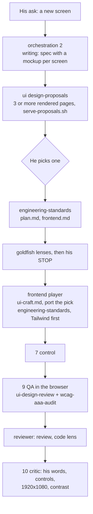
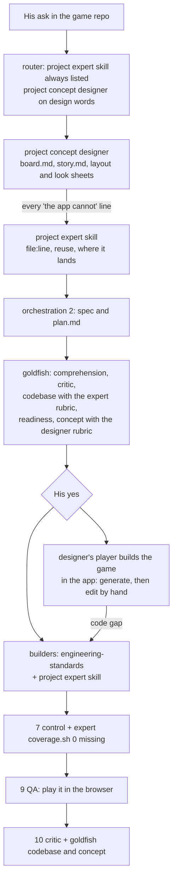
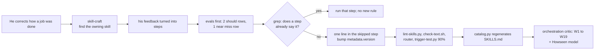
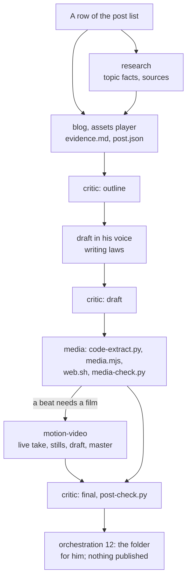
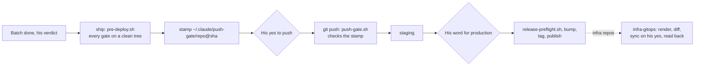
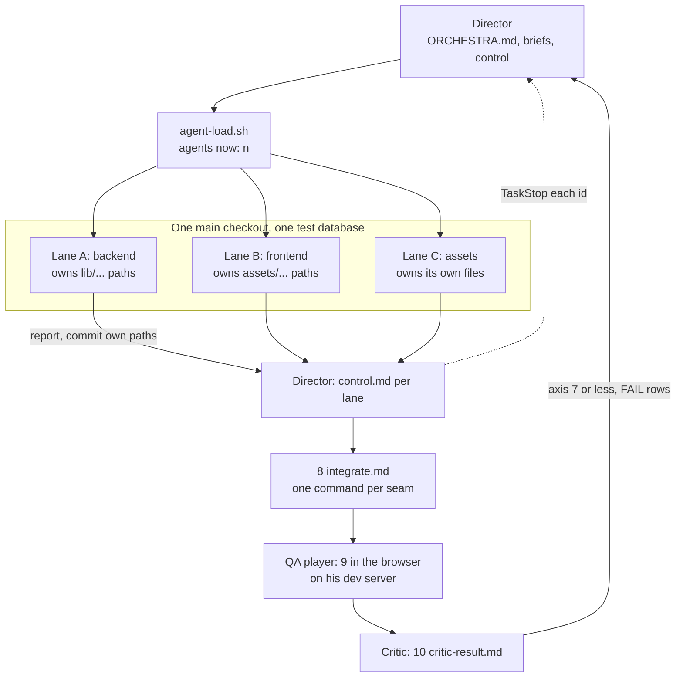
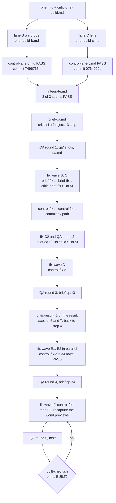
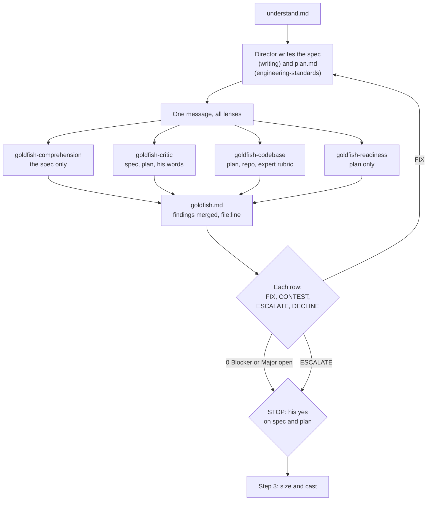
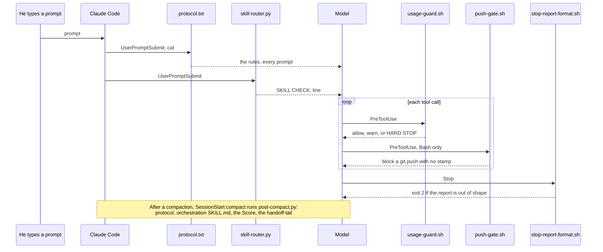

# Diagrams

How the skills hand work to each other, and the layouts a ticket takes through orchestration. Every diagram is
Mermaid; GitHub and most Markdown viewers render it. Step numbers are the orchestration Pipeline steps
([`skills/global/orchestration/SKILL.md`](../skills/global/orchestration/SKILL.md), lines 101 to 117).

## Contents

Skill interaction examples:
1. [A bug ticket](#1-a-bug-ticket)
2. [A UI feature](#2-a-ui-feature)
3. [A game feature with a project expert](#3-a-game-feature-with-a-project-expert)
4. [A skill correction](#4-a-skill-correction)
5. [A blog post](#5-a-blog-post)
6. [A release](#6-a-release)

Harness layouts:
7. [Director with parallel builder lanes on one checkout](#7-director-with-parallel-builder-lanes-on-one-checkout)
8. [Sequential fix waves: the C38 example](#8-sequential-fix-waves-the-c38-example)
9. [The spec stage: four goldfish and his STOP](#9-the-spec-stage-four-goldfish-and-his-stop)
10. [The hook flow of one prompt](#10-the-hook-flow-of-one-prompt)

## 1. A bug ticket

```mermaid
flowchart LR
    U["He reports a bug"] --> SS["session-start<br/>first message only"]
    SS --> O0["orchestration 0 to 1<br/>log his words, understand.md"]
    O0 --> O3["3 to 5<br/>size: small, no spec<br/>brief, critic-brief"]
    O3 --> B["builder runs bug-investigation<br/>reproduce, measure, root cause file:line"]
    B --> T["testing-standard<br/>the bug is the scenario<br/>when the mode wants a test"]
    T --> E["engineering-standards<br/>check-diff.sh, gates"]
    E --> C7["7 control.md"]
    C7 --> Q["9 QA player<br/>testing-standard + bug-investigation<br/>before and after shots"]
    Q --> C10["10 critic-result"]
    C10 --> S["ship<br/>commit by path, push waits for his yes"]
```

A bug sized small at step 3 has no spec of its own, so it skips the goldfish; its brief still goes through the
step 5 critic (`references/critic.md` Goldfish, Size). The builder runs bug-investigation inside step 6, and QA
runs it again on anything it finds at step 9 (bug-investigation lines 15 to 16).

## 2. A UI feature

The ui skill serves three different steps: options at step 2, the build after step 6, and the reviews at step 9
(ui Pipeline, lines 71 to 78). In the default test mode the frontend gets 0 tests; the browser QA is the proof
(testing-standard law 3, orchestration law 9).

## 3. A game feature with a project expert

Every ticket in a repo with an expert skill loads it; any ticket a player sees or plays also gets the concept
designer (orchestration skill map). Both skills sit in the private overlay, `skills/specific/<project>/`. A gap the designer's player hits goes to an expert player as a row,
then the designer's player walks the game again (concept designer law 2).

## 4. A skill correction

A correction never becomes a memory file, a hook or a CLAUDE.md line (CLAUDE.md rule 3). The skill-craft steps
are 2 to 11 of its Pipeline (lines 79 to 93); the critic axes for a skill are in
`orchestration/references/critic.md` lines 27 to 40.

## 5. A blog post

The blog skill runs inside step 6 with three critic passes of its own and the orchestration critic at step 10
(blog Pipeline). Topic picking is research's; a film in a beat is motion-video's; the voice is writing's
(skill map row "blog post").

## 6. A release

Two separate yeses: the push, and production after staging (ship laws 1 and 3). The push gate hook only proves
the gates ran on that exact commit; it never stands in for his yes.

## 7. Director with parallel builder lanes on one checkout

Two or more builders work separate tickets in the same checkout at once, each owning disjoint files; only the
same file or the same check run waits, and `git worktree list` prints 1 line (orchestration law 15,
`references/agent-dispatch.md` laws 1 to 4). QA, reviewer and critic are always other players (law 10).

## 8. Sequential fix waves: the C38 example

The real ticket folder is `$CLAUDE_WORKSPACE/<project>/score/C38/`: a wardrobe and a lens for a game's worlds.

Each wave is the same loop: a fix brief, its critic rounds until every axis is 8 or more, dispatch, a
`control-fix-<lane>.md` with one verdict per requirement and the gates, a commit by path, then a fresh QA round
with its own critic-checked brief. Evidence for each control sits in `fix-check/<lane>/`. The row turns BUILT
only when `built-check.sh` passes on the final `qa/` folder (orchestration step 11 and the BUILT check).

## 9. The spec stage: four goldfish and his STOP

The director is the elephant who holds the context; each goldfish is a fresh read-only agent that knows only
the files in its brief (`references/critic.md` Goldfish, lines 50 to 75). Comprehension never gets his words,
which is the test; concept runs only for a game ticket a player sees or plays. Rows already in his approved
order do not wait at the STOP (orchestration Pipeline).

## 10. The hook flow of one prompt

The protocol arrives twice per session start (SessionStart and the first UserPromptSubmit) and then on every
prompt, so it is always in recent context. The guards run on every tool call, the subagents' included; the Stop
check runs only when the repo has changed files ([`harness.md`](harness.md)).
